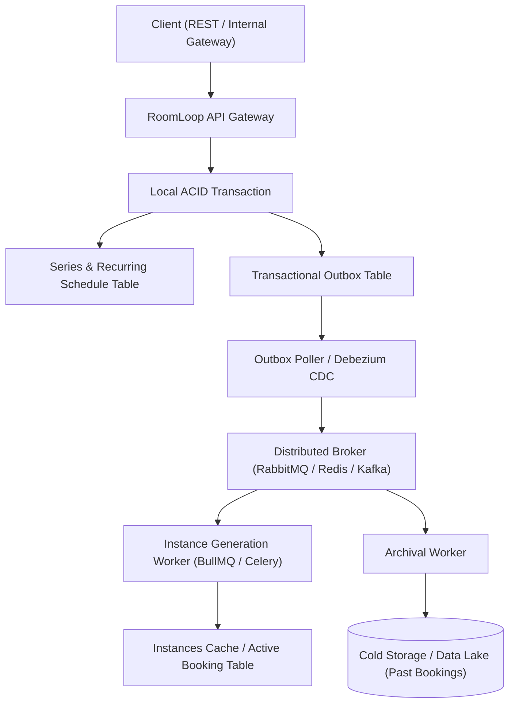

# RoomLoop — Architecture & Engineering Decisions (`DECISIONS.md`)

This document details the architectural decisions, trade-offs, Product Manager questions, AI collaboration log, and future roadmap for the RoomLoop booking service.

---

## (a) Decisions Made Where the Brief Was Silent, and Why

### 1. Reconciling R1 and R2 via the "50% + Max 2 Conflict" Rule
- **The Problem**: The brief has an apparent contradiction. Rule R1 states recurring bookings are "all-or-nothing" (if it cannot be fully created, nothing is saved). Rule R2 states that if 1 or 2 instances conflict, we should skip them and book the rest. If a user requests a 1-instance or 2-instance series and all slots are occupied, blindly applying R2 would create zero bookings while returning a "success" response.
- **The Decision**: A recurring series is accepted if and only if:
  1. Conflicting slots $C \le 2$ (satisfies R2).
  2. Successfully created slots $S \ge 0.5 \times N$ (at least 50% of the series succeeds).
  3. At least 1 meeting is created ($S \ge 1$).
  If these conditions are not met, the entire request rolls back atomically with `409 Conflict` (satisfies R1).
- **Why It Matters**: This prevents users from ending up with empty or hollow recurring bookings, while still granting the flexibility to skip occasional one-off conflicts.

### 2. Room-Local Naive ISO Timestamps (Fixing Denver's Winter Drift)
- **The Problem**: The Office Manager reported that Denver meetings drifted by one hour in winter (OM-2). This bug occurs when systems convert local meeting times into UTC and add 7 days as seconds ($7 \times 86400$). Because Denver shifts between Mountain Daylight Time (UTC-6) and Mountain Standard Time (UTC-7) at different dates than headquarters in Berlin, UTC math causes local wall-clock times to shift.
- **The Decision**: All meeting timestamps are stored as canonical naive ISO strings (`YYYY-MM-DDTHH:MM:SS`) in the room's local timezone. Weekly recurrences add 7 calendar days directly to the local wall-clock time (`current_start + timedelta(days=7)`).
- **Why It Matters**: A 09:00 meeting in Denver remains at 09:00 local wall-clock time year-round, completely eliminating the 1-hour winter drift while fulfilling Contract C1 for the nightly reporting script.

### 3. Rejection of Non-Existent Wall-Clock Times (Spring-Forward DST Gaps)
- **The Problem**: When clocks jump forward in spring (e.g., Europe/Berlin jumps from 02:00 to 03:00 on 2027-03-28), the time `02:30:00` does not physically exist. Accepting it would cause undefined behavior in downstream calendar consumers.
- **The Decision**: Every submitted timestamp is validated against the room's `zoneinfo.ZoneInfo`. Any timestamp falling into a spring-forward transition gap is rejected with `422 Unprocessable Entity`. Ambiguous fall-back times (when clocks repeat an hour in autumn) are resolved deterministically using `fold=0`.
- **Why It Matters**: Prevents invalid phantom bookings from entering the database.

### 4. Preserving the Facilities Dashboard (Contract C2) with Strict API Versioning
- **The Problem**: The facilities dashboard calls `GET /rooms` and "renders whatever comes back" (Contract C2). Leaking internal database columns or restructuring that endpoint would break third-party scrapers and dashboards.
- **The Decision**: We isolate `GET /rooms` at the root specifically for Contract C2 compatibility, returning strictly `[{"id": int, "name": str, "capacity": int}]` with extra fields forbidden (`ConfigDict(extra="forbid")`). All booking endpoints are strictly versioned under `/api/v1/bookings`.
- **Why It Matters**: Allows the core booking API to evolve safely under `/api/v1` without breaking legacy dashboard integrations.

### 5. Dynamic Room Discovery (Refuting the Sequential 1..N Assumption)
- **The Problem**: Rule R5 suggests room availability can be checked by iterating room IDs from $1 \dots N$. However, Contract C2 demonstrates that the actual room IDs are non-sequential (`[3, 4, 9, 17]`).
- **The Decision**: The system treats room IDs as arbitrary database primary keys. Requests for missing rooms (`1, 2, 5..8`) return `404 Not Found` rather than assuming contiguous allocation.
- **Why It Matters**: Real-world office facilities expand, decommission, and renumber rooms over time. Hardcoding contiguous ID ranges would cause crashes or false availability reports.

### 6. Room-Local Cutoff for Series Cancellation (Resolving OM-1)
- **The Problem**: The Office Manager's top complaint was that people book rooms for months, the team dissolves, and the room sits "busy" forever because cancelling a whole series was impossible (OM-1). However, historical meetings must remain intact for nightly reporting (Contract C1).
- **The Decision**: Calling `DELETE /api/v1/bookings/series/{id}` evaluates the current time in the room's specific timezone. Meetings that have already occurred or are in progress remain `status="active"`, while all future occurrences are soft-deleted (`status="cancelled"`), immediately freeing those slots for other teams.
- **Why It Matters**: Completely solves OM-1 without corrupting historical audit and reporting logs.

### 7. Preventing Race Conditions and Double Bookings (`BEGIN IMMEDIATE`)
- **The Problem**: In SQLite, the default transaction mode is `DEFERRED`. Two concurrent HTTP requests can both read the database at the same time, see a free slot, and simultaneously write their bookings, causing a double booking.
- **The Decision**: We enabled Write-Ahead Logging (`PRAGMA journal_mode=WAL`) and registered an engine listener that executes `BEGIN IMMEDIATE` at the start of every transaction. This immediately acquires a reserved write lock before conflict checks execute.
- **Why It Matters**: Guarantees serializable isolation at the database level. Tested with 8 concurrent worker threads: exactly 1 request succeeds and 7 fail with `409 Conflict`, with zero double bookings.

### 8. Dual-Layer Logging (Non-Blocking Asynchronous Queue + Immutable Audit Table)
- **The Problem**: Synchronous logging directly to `stdout` causes every log emission to execute blocking I/O, slowing down HTTP handlers and degrading request throughput under concurrent traffic. Furthermore, real-time console logs can be lost upon container restart.
- **The Decision**: Standardized on dual-layer logging:
  1. Real-time application logging uses Python's standard `QueueHandler` and `QueueListener` running on a dedicated background worker thread. HTTP requests enqueue log records instantaneously into a non-blocking in-memory queue without waiting on console I/O.
  2. An append-only SQLite `audit_logs` table records all lifecycle events (`BOOKING_CREATED`, `SERIES_CREATED`, `CONFLICT_SKIPPED`, `SERIES_ROLLED_BACK`, `BOOKING_CANCELLED`, `SERIES_CANCELLED`) within database transactions.
- **Why It Matters**: HTTP request handlers remain lightning fast with zero console I/O blocking, while operators retain an immutable audit trail for compliance and conflict diagnosis.

### 9. Meeting Duration Bounds & Recurrence Horizon
- **The Problem**: The brief did not specify whether multi-day meetings are permitted or if there is a maximum recurrence window.
- **The Decision**: We enforce `start < end`, require single meeting duration to be strictly `< 7 days` (allowing multi-day workshops or hackathons while preventing a meeting from self-overlapping with its next weekly occurrence), enforce `repeat_until >= end_dt.date()`, and cap recurrence at 52 weeks (1 year).
- **Why It Matters**: Protects the database from unbounded infinite recurrence loops and memory exhaustion while supporting realistic workplace events.

### 10. Decoupling Database Seeding from Server Boot
- **The Problem**: Automatically populating prototype data on server boot (`server.start()`) causes unexpected data mutations in staging and production environments and masks unseeded database states.
- **The Decision**: Removed automatic seeding from the server startup sequence. The server ensures table schemas exist, emits a startup log reminder to run `make seed` or `uv run python -m roomloop.seeding`, and leaves seed execution to explicit operator control.
- **Why It Matters**: Follows standard 12-factor application lifecycle practices where migrations and seeding are explicit deployment steps.

### 11. REST API Chosen over CLI Interface
- **The Problem**: The brief allowed choosing between a REST API and a CLI.
- **The Decision**: A REST API was chosen because Contract C2 explicitly requires integrating with the facilities dashboard, which queries `GET /rooms` over HTTP. A CLI cannot service external web dashboards, support concurrent client connections, or provide live OpenAPI Swagger documentation.

### 12. Explicit Environment Isolation (`production`, `development`, `test`)
- **The Problem**: Relying on ambient developer workstation settings risks tests mutating persistent development databases or running production servers with permissive debug log levels.
- **The Decision**: Hardened all runtime entry points with explicit environment configurations:
  - `make start` explicitly enforces `ENVIRONMENT=production`.
  - `make dev` explicitly enforces `ENVIRONMENT=development`.
  - `make test`, `make test-v`, `make verify`, and `conftest.py` strictly enforce `ENVIRONMENT=test`.
- **Why It Matters**: Guarantees zero risk of accidental state leakage or misconfiguration across execution boundaries.

### 13. First-Class Internal API Usability & Microservice Interoperability
- **The Problem**: Internal microservices, backend workers, and web dashboards built by other teams need to consume RoomLoop reliably without protocol mismatches, cross-origin blocking, or tracing blind spots.
- **The Decision**: Designed the service for universal internal API adoption:
  1. *OpenAPI & Discovery*: Complete OpenAPI 3.1 specification exposed at `/openapi.json`, Swagger UI at `/docs`, and ReDoc at `/redoc`.
  2. *CORS Support*: Permissive CORS middleware enabled (`allow_origins=["*"]`) so internal browser-based dashboards on different ports or domains can query the service without browser origin errors.
  3. *Distributed Request Tracing (`X-Request-ID`)*: HTTP middleware extracts incoming `X-Request-ID` headers (or generates unique 12-char hex correlation IDs if omitted), returns them in response headers, and logs them alongside request duration in milliseconds for cross-service observability.
  4. *Container Health Checks*: `/health` endpoint reporting service readiness, active environment, and live database pool connectivity (`200 OK` or `503 Service Unavailable`).
  5. *Dual Integration Modes*: Internal clients can interact over standard HTTP REST or import the package directly in Python as an in-process ASGI sub-application (`main_app.mount("/roomloop", app)`) or via domain services without network latency.
- **Why It Matters**: Enables any internal service (Python, Go, Node.js, frontend portals, or automated crons) to integrate with RoomLoop in minutes.

### 14. Standard Entity Timestamps & Audit Metadata
- **The Problem**: The prototype entities lacked creation, update, and deletion tracking, preventing operators from diagnosing when records were created or soft-deleted.
- **The Decision**: Added standard ISO UTC timestamp columns (`created_at`, `updated_at`, `deleted_at`) across all entities (`rooms`, `bookings`, `series`, `audit_logs`).
- **Why It Matters**: Provides full data lifecycle visibility, enables soft deletions without data loss, and supports auditing and compliance requirements.

---

## (b) Questions to Ask the Product Manager Before Shipping

1. **Room Inventory vs. Bookable Catalog**:
   - Why are room IDs 1, 2, and 5 through 8 missing from Contract C2? Are those non-meeting facilities (phone booths, storage, cafeteria), or rooms temporarily taken offline for maintenance? Should we add an admin endpoint to toggle room availability?

2. **Meeting Duration Bounds & Slot Snapping**:
   - The system currently allows any positive duration under 7 days. Does company policy require enforcing a minimum duration (e.g., 15 or 30 minutes) and snapping bookings to standard clock intervals (e.g., :00, :15, :30, :45) to prevent fragmented calendar schedules?

3. **Nightly Reporting Timezone Expectations**:
   - Contract C1 states reporting parses naive local ISO strings. Does the reporting pipeline expect each room's timestamps in its local timezone (Berlin in CEST/CET, Denver in MDT/MST), or should there be an option to export normalized UTC timestamps?

4. **Recurrence Frequency Flexibility**:
   - Currently, recurrence is strictly weekly (every 7 calendar days). Do teams require bi-weekly, monthly, or custom multi-day schedules (e.g., every Tuesday and Thursday) in the next release?

5. **In-Progress Meeting Cancellation Policy**:
   - When an Office Manager cancels a series while a meeting is currently underway, should the ongoing meeting be terminated immediately or allowed to conclude normally (as currently implemented)?

6. **Individual Instance Cancellation vs. Series Integrity**:
   - Currently, attempting to delete a single occurrence of a recurring series returns `400 Bad Request` to preserve series integrity and satisfy OM-1. Should users ever be allowed to cancel a single instance (e.g., skip a meeting for a public holiday), or should we model exceptions using RFC 5545 `EXDATE` patterns?

7. **Series Conflict Policy Customization**:
   - Is the "50% + max 2 conflicts" rule appropriate across all rooms, or should high-demand executive boardrooms enforce a strict 100% all-or-nothing policy?

8. **Data Retention & Soft-Deletion Lifecycle**:
   - How long should cancelled bookings and immutable audit logs be retained before being archived or purged under corporate compliance and GDPR policies?

9. **Series Horizon Limits**:
   - Is the 52-week recurrence cap aligned with internal calendar guidelines, or should it be configurable per office location?

---

## (c) Where AI Helped and What It Got Wrong That Was Corrected

### Where AI Helped
1. **Timezone Transition Dates**: AI accurately identified the specific 2026/2027 DST change dates for Berlin (`2026-10-25`) and Denver (`2026-11-01`), speeding up test fixture creation.
2. **Test Scenario Generation**: AI assisted in rapidly generating parameter matrices for overlapping interval boundary conditions.

### What AI Got Wrong and How It Was Corrected
1. **Fabricating an Unmandated 24-Hour Meeting Limit**:
   - *What AI Got Wrong*: When evaluating a valid multi-day booking request (`start: 2026-11-05`, `end: 2026-11-07`, `repeat_until: 2026-11-06`), AI hallucinated that "meetings cannot exceed 24 hours" and attempted to reject all multi-day bookings.
   - *Correction*: Multi-day workshops and hackathons (< 7 days) are completely valid. The actual bug was that recurrence validation did not verify `repeat_until >= end_dt.date()`. I corrected the boundary check so multi-day meetings succeed whenever `repeat_until` accommodates the meeting's conclusion date.

2. **Permitting Individual Cancellation of Series Occurrences**:
   - *What AI Got Wrong*: AI naively soft-deleted any booking ID passed to `DELETE /bookings/{id}` without checking whether it belonged to a recurring series. This allowed users to cherry-pick single occurrences, leaving orphaned future meetings and breaking the Office Manager's series cancellation requirement (OM-1).
   - *Correction*: Added a check in `cancel_single_booking` rejecting series bookings with `400 Bad Request`. Recurring reservations must be cancelled via `DELETE /api/v1/bookings/series/{id}`, ensuring all future meetings are cancelled cleanly and consistently.

3. **SQLite Re-Entrant Lock Deadlock**:
   - *What AI Got Wrong*: In the initial cancellation implementation, AI opened a second database connection inside an active `BEGIN IMMEDIATE` transaction to lookup the room's timezone. Because SQLite allows only one writer at a time, the second connection hung indefinitely waiting for the first lock to release.
   - *Correction*: Refactored `RoomRepository.get_by_id(room_id, session=None)` to accept and reuse the active session, eliminating the self-deadlock.

4. **Audit Trail Rollback Contamination**:
   - *What AI Got Wrong*: When a series exceeded conflict thresholds, AI raised an HTTP 409 exception inside the active database session. This inadvertently rolled back the `SERIES_ROLLED_BACK` audit record along with the rejected bookings.
   - *Correction*: Refactored the service to explicitly rollback the booking session first, then commit the audit record in an independent transaction.

5. **Argon's Flawed Conflict Rule**:
   - *What AI Got Wrong*: AI referenced competitor code (Argon) that blindly skipped up to 2 conflicts without checking overall success rate, which caused a 2-instance series with 2 conflicts to create 0 bookings while returning success.
   - *Correction*: Formulated and implemented the 50% threshold formula ensuring at least 1 booking succeeds and at least 50% of the series is created.

6. **Missing Spring-Forward DST Gap Validation**:
   - *What AI Got Wrong*: AI used naive date math that allowed non-existent local times (e.g., 02:30 during the Berlin spring-forward transition).
   - *Correction*: Added `validate_local_wall_time` using `zoneinfo` fold checks to reject non-existent clock times with `422`.

7. **Outdated Package Versions**:
   - *What AI Got Wrong*: AI web searches recommended outdated package versions.
   - *Correction*: Verified all packages directly against PyPI (FastAPI 0.156.1, SQLAlchemy 2.1.5, Pydantic 2.14.1).

---

## (d) Deliberate Omissions and What to Build Next

### 1. User Authentication & Role-Based Access Control (RBAC)
- **Why Omitted**: The brief asked for an internal booking core without authentication specifications. Adding mock JWT or session auth would add unnecessary friction and break third-party scrapers.
- **What to Build Next**: Integrate OpenID Connect (OIDC) / Google Workspace OAuth2 to enforce role permissions (standard employees vs. facilities managers).

### 2. Distributed Database (PostgreSQL)
- **Why Omitted**: SQLite Write-Ahead Logging (`WAL`) with `BEGIN IMMEDIATE` provides full ACID guarantees, zero deployment overhead, and serializable write locking for single-instance deployments.
- **What to Build Next**: Introduce a PostgreSQL adapter utilizing `SELECT ... FOR UPDATE` row-level locks for multi-node Kubernetes deployments.

### 3. Granular Series Exception Editing
- **Why Omitted**: Rescheduling individual instances of an active series (e.g., moving next Tuesday's meeting by 1 hour) introduces split-series edge cases beyond the brief's scope.
- **What to Build Next**: Implement RFC 5545 `EXDATE` exception tracking to allow modifying single instances without severing the series parent.

### 4. Real-Time Calendar Integrations & Webhooks
- **What to Build Next**: Outgoing webhooks and bidirectional sync with Google Calendar and Microsoft Outlook APIs.

### 5. Room Amenities & Capacity Filtering
- **What to Build Next**: Add query filters to `GET /rooms` (e.g., `?min_capacity=10&has_video=true`) allowing teams to search rooms by physical capabilities.

---

### Phase 2: Enterprise Event-Driven Scale-Out Architecture

In a global enterprise deployment handling thousands of rooms and millions of recurring meetings (similar to Google Calendar), generating years of instances upfront causes **database row explosion** and high write contention.

The Phase 2 architecture scales the service across distributed nodes using the **Transactional Outbox Pattern** and **Just-In-Time (JIT) Rolling Instance Generation**:

#### Key Components:
1. **Transactional Outbox Pattern**:
   Instead of writing hundreds of future booking rows inside the client request cycle, the API stores a single `recurring_schedule` row and an atomic `outbox_events` record in the database within a single local transaction. An asynchronous change-data-capture (CDC) agent or outbox poller reads events with lease-based row locking (`SELECT ... FOR UPDATE SKIP LOCKED`) and publishes them to the message broker.
2. **Just-In-Time (JIT) Instance Generation via Delayed Queue**:
   A distributed worker schedules instance generation jobs in 30-day rolling windows rather than all at once. This keeps active table indexes small and query latencies in the sub-millisecond range.
3. **Optimistic Locking & Cancellation Distribution**:
   Cancelling a series publishes a `SeriesCancelledEvent` to the message broker. A cancellation worker cancels pending delayed generation jobs and marks future rolling instances as cancelled, while archiving past completed meetings into cold storage (Parquet / S3 / ClickHouse) for reporting.
4. **Exponential Backoff & Dead-Letter Queues (DLQ)**:
   Worker tasks incorporate exponential backoff with jitter to handle database transient connection drops or lock contentions without data loss.
